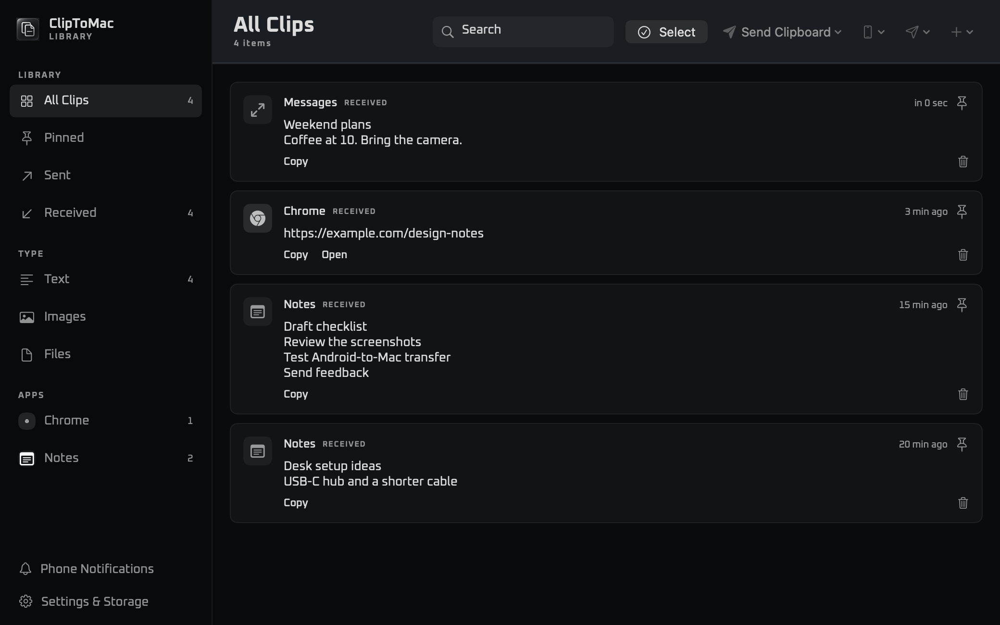
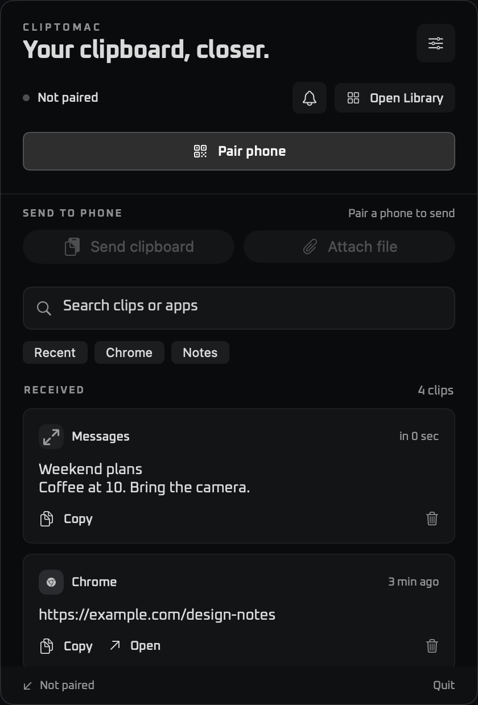

# ClipToMac for macOS

ClipToMac pairs a Mac with an Android phone so you can move text, links, images, and files over your local network. The Mac library lets you search clips and pin items. You can also opt in to mirror Android notifications from selected apps.

[Companion app for Android](https://github.com/vedraj360/cliptomac-android) · [Website](https://cliptomac.github.io/)

## Screenshots





## Install from source

Requires an Apple silicon Mac running macOS 13 or later and the Xcode Command Line Tools. If the tools are missing, run `xcode-select --install` and complete the installer before building.

```sh
git clone https://github.com/vedraj360/cliptomac-mac.git
cd cliptomac-mac
./build.sh
```

Open the `ClipToMac.app` bundle at the path printed by the build. To keep it after the temporary build directory is cleared, move the bundle to **Applications** and open that copy. Install the [Android companion](https://github.com/vedraj360/cliptomac-android#install-from-source) before pairing.

## Pair and set up

1. Connect the phone and Mac to the same local network. Keep ClipToMac running on the Mac.
2. On the Mac, open **Library → Settings & Storage → Secure Pairing**. Choose **Show pairing QR** or **Add or re-pair a phone**.
3. On Android, open **Pair Mac securely → Scan QR**, allow camera access if prompted, and scan the Mac’s code.
4. Compare the six-digit code shown on both devices and approve the request on the Mac. If the QR expires, generate a new one.
5. Test Android to Mac by sharing a link from another Android app to ClipToMac. Check **Library → Received** on the Mac. To test the reverse direction, copy a short sample on the Mac and use **Send Clipboard** in the Library. If automatic receiving is off on Android, open ClipToMac to receive it.

### Optional features

- **Android copy overlay:** Enable **Copy detection** in Android Accessibility settings and allow ClipToMac to display over other apps. Turn off **Show in all apps** and tap **Choose apps** to limit where it appears. Use Android’s Share menu when automatic copy detection misses an app.
- **Phone notifications:** Enable **Forward app notifications to Mac** in Android settings inside ClipToMac, grant notification access, and choose the apps to forward. On Mac, enable **Forward Android notifications** under **Settings & Storage → Phone Notifications** and choose **macOS notifications** or **Custom banners**. Use **Library → Phone Notifications** for saved alerts.

### Troubleshooting

- **Mac unavailable:** Check that both devices can reach each other on the same network. Guest Wi-Fi may isolate devices. If prompted, allow ClipToMac local network access on the Mac.
- **Pairing code expired or Mac identity changed:** Start a new pairing from the Mac and scan the fresh QR on Android.
- **Alerts missing:** Check forwarding and app selection on Android and Mac. For native alerts, also check the Mac’s ClipToMac notification permissions, banner style, and Focus settings.

## Privacy and security

Pairing uses a one-use QR code and HTTPS pinned to the Mac identity. The Mac stores pairing credentials in Keychain. Clip history is kept locally, and mirrored notification previews can appear in macOS Notification Center. See the [pairing protocol](docs/SECURE_PAIRING_V3.md) and [security review](docs/SECURITY_REVIEW.md) for the threat model and remaining release validation.

## Roadmap

- Improve clipboard detection across Android apps and document where Android limits it.
- Add more control over which conversations and Android profiles can mirror notifications.
- Make pairing and installing both apps easier with documented release builds.

Have an idea for a future app or integration? Open an issue describing the device or platform, the workflow you want, and what you use today.

## Contribute

Pull requests are welcome. Fork this repository, create a branch, and open a pull request against `main`. Describe the problem, the change, and how you checked it. For UI changes, include screenshots with sample data. For larger features, open an issue first so we can discuss scope.

Read [AGENTS.md](AGENTS.md) and [DESIGN_SYSTEM.md](DESIGN_SYSTEM.md). Build the app and run the Swift regression harnesses:

```sh
for harness in Tests/*/run.sh; do bash "$harness" || exit 1; done
```

Use synthetic clips and redact QR codes, tokens, message previews, and private paths from reports.
## Noncommercial license

You can use, modify, and share ClipToMac for noncommercial purposes under the [PolyForm Noncommercial License 1.0.0](LICENSE). Commercial use requires separate permission.

Brand icon notices are in [Assets/BrandIcons](Assets/BrandIcons/LICENSE.md).

## Website

See features, screenshots, and installation instructions on the [ClipToMac website](https://cliptomac.github.io/).
